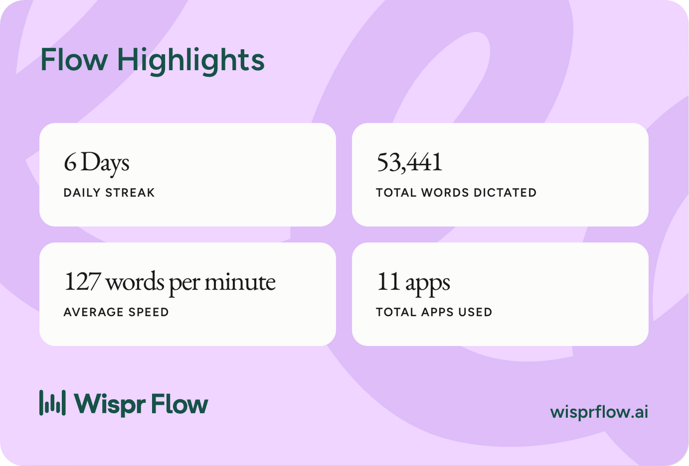
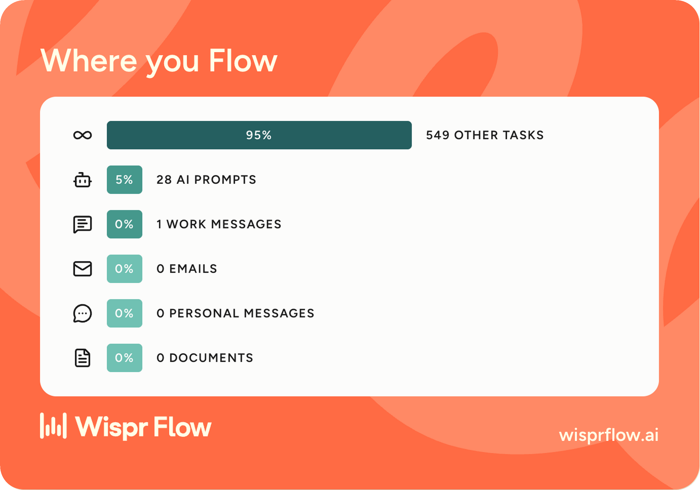

# Rehearse

**Talk your voice bot into shape, then call it before your customers do.**
Build, rehearse and fix a phone voice agent just by speaking, in Telugu, Hindi or English.

[Try it live, no sign-in →](https://rehearse-ecru.vercel.app) · [Demo video (1:55)](https://youtu.be/u4y-gDxb1ZQ) · [Blog post](https://dev.to/sudarshan032/i-stopped-finding-voice-bot-bugs-on-real-calls-now-i-rehearse-them-by-voice-2l9m) · [LinkedIn](https://www.linkedin.com/posts/sudarshansastry_nohandschallenge-nohandschallenge-wisprflow-share-7520940328674078720-W7Wn/) · Builders track, No Hands: The Wispr Challenge

**Who it's for:** me, an AI engineer who builds voice bots for Indian businesses, and anyone who knows how a call
should go but doesn't want to write prompts or drag boxes.

## Proof

| | |
|---|---|
| **Before (my real work, Sep–Oct 2026)** | 7 voice agents, 22 live bots in 3 languages. One sales bot went live in 1 day but took about 3 weeks and about 87 prompt saves before it stopped breaking rules. Every break was found only after calls: about 61 hands-on hours, 58 recordings reviewed by hand. ([how I measured](docs/results.md)) |
| **After (Rehearse)** | Same kind of bot, rebuilt by voice: built in 1.7 min, first rule break caught in a rehearsal 3.1 min after the brief, before any caller. ([timings](docs/results.md)) |
| **Wispr usage** | Official Wispr Flow card (29 Oct): **53,441 words dictated, 127 words per minute, 6-day streak, 11 apps** (card below, [daily log](docs/voice-log.md)) |
| **Built by voice** | Every prompt to Claude Code and most commit messages were dictated with Wispr Flow |

<p> </p>

## Try it in one minute

1. Open the site and click **Watch a bot break a rule**. A Telugu caller asks about a refund; the bot promises one and
   **rule 1 turns red** on the flow and in the rules list.
2. Hold your Wispr key and say the fix: *"if they ask for a refund, say the trial is free and offer a manager
   callback"*. **Changes** shows before and now; say **"replay"**: same caller line, new answer, rule kept.
3. Go to **Voice test** and press the call button. The bot speaks, you answer out loud, and you can cut in while it
   talks, like a real call.
4. Build your own: describe the bot in any language. It asks a few short questions; answer them in one go.

No Wispr? Type in the same box; it works the same. The sample bot and its saved call work even with the AI off.

## The problem

At work I build voice bots. The owner explains the call by talking, often in Telugu or Hindi mixed with English.
I turn that into prompts by hand, then test with real phone calls and read transcripts. Rule breaks ("the bot
promised a refund", "it hung up when the caller said hmm") are found by callers, weeks later. Every voice-bot builder
(Vapi, Retell, Voiceflow, Synthflow) is still built by typing and dragging, and none checks your rules during a test.

## Why voice

A call script with branches, exceptions and "never say this" rules is how people already explain things out loud.
Saying it is faster than typing it, and playing the caller by voice is the natural way to test a voice bot. Wispr Flow
turns messy mixed-language speech into clean text in the one box Rehearse listens to.

## How it works

- **One box, three jobs:** the brief, playing the caller, and the fix. Click a step or rule to point at it
  (`@Greet`, `@Rule 2`, `@Last reply`) and say what to change.
- **Rule-based first:** navigation ("show the rules", "next", "back", "scroll down"), keyword rule checks and the flow
  layout are plain code. The AI is asked only when needed.
- **AI (free tier):** Groq `gpt-oss-120b` writes the questions, the blueprint (flow, rules, facts) and the bot's
  replies, checks unclear rule breaks, and applies spoken edits as small patches. A fix may never remove a rule
  unless you say so.
- **Voice test:** Groq Whisper hears you, the bot speaks the reply with each word lit up, and you can cut in
  (barge-in). The call follows the caller's language, even when they switch mid-call. Telugu is spoken by a natural
  Piper voice that runs in your browser (63 MB, downloaded once); English and Hindi use the browser's voices.
- **The prompt is compiled** from the flow, rules and facts, so what you see is what the bot runs on.
- **Export, honestly:** copy the prompt anywhere, or ready API commands for Vapi and Retell, a Pipecat starter, or a
  full backup.

## Run it locally

```sh
npm install
cp .env.example .env   # add GROQ_API_KEY (free); OPENROUTER_API_KEY optional
npm run dev            # http://localhost:3000
```

## What it does not do (yet)

- No real phone numbers; calls happen in the browser.
- The voice test uses free voices: good enough to hear the call, not production quality (export to Murf or similar).
- Bots live in your browser only; no accounts, no sync.

## How it was built

- Built solo, 23–30 Oct 2026, for No Hands: The Wispr Challenge (WeMakeDevs × Wispr Flow).
- **AI assistance:** I directed Claude Code by voice (Wispr Flow) and reviewed every change. The product uses Groq's
  free tier.
- Stack: Next.js, TypeScript, plain CSS, zod, Groq.
- Telugu voices: [Piper](https://huggingface.co/rhasspy/piper-voices) te_IN (Padmavathi, Maya, Venkatesh), trained
  on [IIT Madras IndicTTS](https://www.iitm.ac.in/donlab/indictts) data, free for non-commercial use.
